# Valio Aimo -tilausapuri

[](https://github.com/eeputti/aimo-ai/actions/workflows/test.yml)

**Ammattikeittiö tilaa Valio Aimon tuotteet kirjoittamalla, puhumalla tai lähettämällä kuvan WhatsAppiin, kuten myyjälle.** Apuri kysyy ensin toimituspäivän, näyttää sille päivälle tilattavat Valion tuotteet numeroituina ja kokoaa ostoskorin. Kokki tarkistaa korin kaupan näköisellä sivulla ja vahvistaa tilauksen itse. Jokainen tilaus kulkee agenttiportin läpi: hinnat lukitaan allekirjoitettuun tarjoukseen, ostajan valtuudet tarkistetaan koodilla ja jokainen päätös jää lokiin.

Tehty Valion Junction 2026 -haasteeseen. Tämä on kehitysrepo, josta botti julkaistaan. Sama koodi ilman työlokeja ja kehitysraportteja: [eeputti/valioaimo-tilausapuri](https://github.com/eeputti/valioaimo-tilausapuri).

**Kokeile selaimessa:** [aimo-order-demo.aimo-demo-41cfac.workers.dev](https://aimo-order-demo.aimo-demo-41cfac.workers.dev). Keskustele-välilehti käyttää samaa apuria kuin WhatsApp.

<p align="center">
  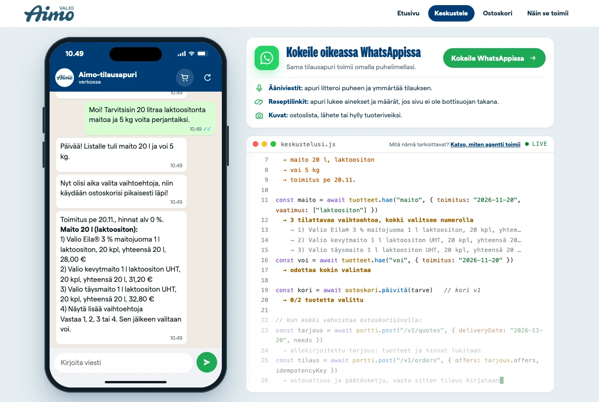
</p>

## Kenelle ja miksi

Ravintolan, henkilöstöravintolan tai keskuskeittiön kokki tilaa usein kiireessä puhelimella. Verkkokaupassa hän joutuu hakemaan jokaisen tuotteen, laskemaan pakkauskoot ja tarkistamaan toimituspäivät itse. Apuri tekee tämän keskustelussa:

- **Puhekieli ja kirjoitusvirheet:** "20 l laktoositonta maitoo perjantaiks", "pottu", "jätski".
- **Ääniviestit:** puhe litteroidaan ja käsitellään kuten kirjoitettu viesti.
- **Kuvat:** ostoslistasta, lähetteestä tai hyllystä luetut rivit menevät samaan koriin.
- **Reseptilinkit:** ainekset ja määrät luetaan sivulta. Jos aines ei ehdi toimituspäivälle, apuri ehdottaa korvaajaa.
- **"Se tavallinen" ja "sama kuin viimeksi":** ostajan toistuvat tuotteet aiemmista tilauksista uusilla hinnoilla.
- **Vertailu:** halvin, pienin hiilijalanjälki tai varmin toimitus Valion tuotetiedoista.
- **Puuttuvat määrät:** arvioidaan annetusta määrästä suurkeittiön annoskoilla, ja apuri kertoo, miten arvio laskettiin.

Tuotetiedot (allergeenit, alkuperä, kuvat, vertailuhinnat) tulevat vain Valion datasta. Kielimalli ei keksi tuotteita, hintoja eikä saatavuutta, eikä se päätä tilauksesta.

## Koko kulku

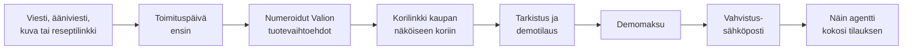

### 1. Kokki kertoo tarpeen

Tekstinä, ääniviestinä, kuvana tai reseptilinkkinä. Apuri kuittaa, mitä listalle tuli, ja kysyy puuttuvat tiedot yhdellä kysymyksellä.

### 2. Toimituspäivä ensin

Tuotteita ei haeta ennen päivää, koska saatavuus ja tilausaika riippuvat siitä. "Huomiseksi" tai "ensi tiistaina" riittää. Jos päivä ei ehdi, apuri kertoo aikaisimman mahdollisen päivän eikä lupaa mitään, mitä rajapinta ei vahvista.

### 3. Numeroidut vaihtoehdot

Jokaiselle tuotteelle kolme sille päivälle tilattavaa Valion tuotetta: pakkausmäärä, toimitettava kokonaismäärä ja hinta. Kokki vastaa numerolla, ja 4 näyttää lisää vaihtoehtoja. Ruokavalio (esim. laktoositon) rajaa vaihtoehdot, ja allergeenikiellot tarkistetaan koodilla.

### 4. Korilinkki kaupan näköiseen koriin

Kun kaikki on valittu, kokki vastaa "ok" ja saa yksityisen linkin ostoskoriin. Kori näyttää samalta kuin Valio Aimon verkkokauppa ja käyttää samaa luonnosta kuin keskustelu, joten muutokset näkyvät molemmissa. Huomiot, kuten "Hinta ei ole ajantasainen" tai "Saldoa ei vahvistettu", näkyvät korin yläpuolella.

<p align="center">
  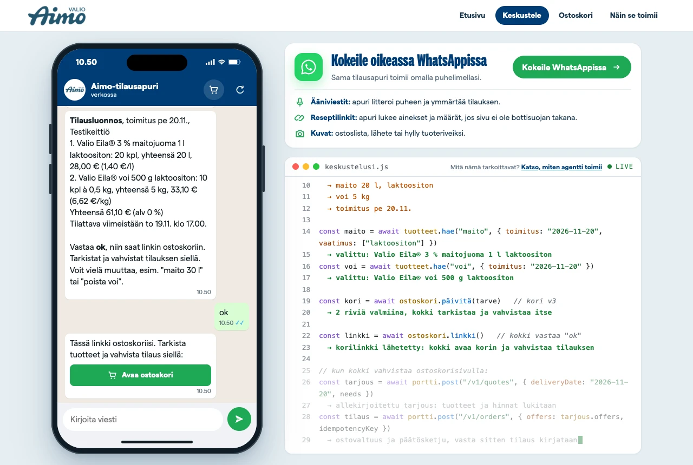
</p>
<p align="center">
  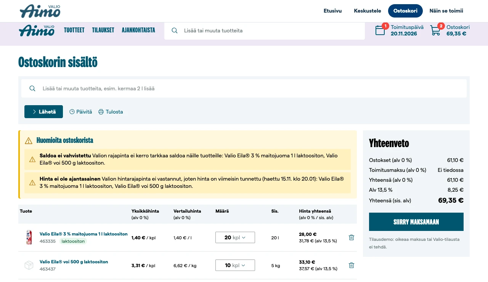
  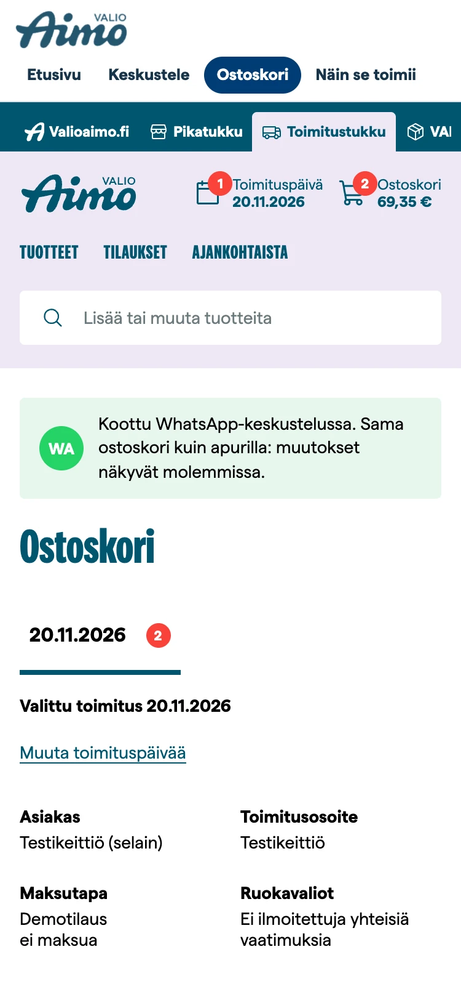
</p>

### 5. Tarkistus ja demotilaus

**Siirry maksamaan** pyytää agenttiportilta tuoreen, allekirjoitetun tarjouksen ja vahvistaa tilauksen samalla. Portti tarkistaa hinnan ja saatavuuden uudelleen, ostajan valtuudet (tilaus- ja päiväkatto, ruokavalio, allergeenit) ja estää kaksoistilaukset. Valtuudet ylittävä tilaus jää odottamaan ihmisen hyväksyntää.

### 6. Demomaksu

Maksusivu näyttää tilauksen, toimituspäivän ja summan. Maksutapana on testikortti tai lasku. Rahaa ei siirry, eikä sivulla kysytä oikeita korttitietoja. Linkki on henkilökohtainen: tilaus näkyy vain sille, jolla linkki on.

<p align="center">
  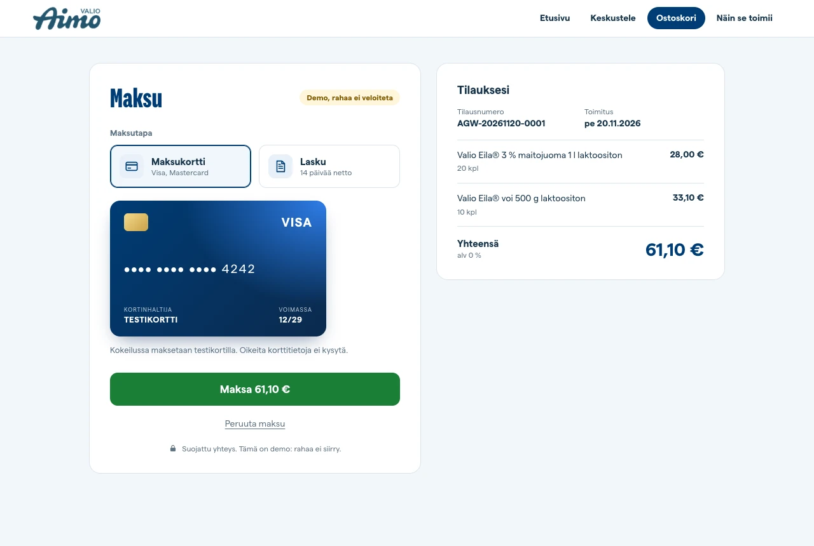
  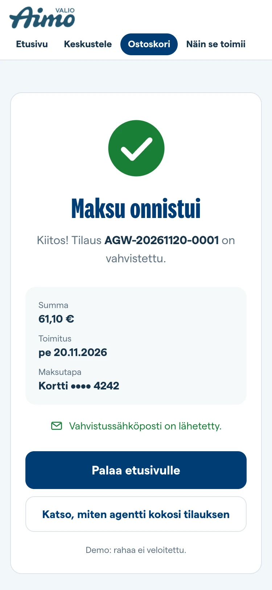
</p>

### 7. Vahvistussähköposti

Maksun jälkeen Worker lähettää vahvistusviestin demon testiosoitteeseen (`ORDER_EMAIL_TO`), kerran tilausta kohden.

<p align="center">
  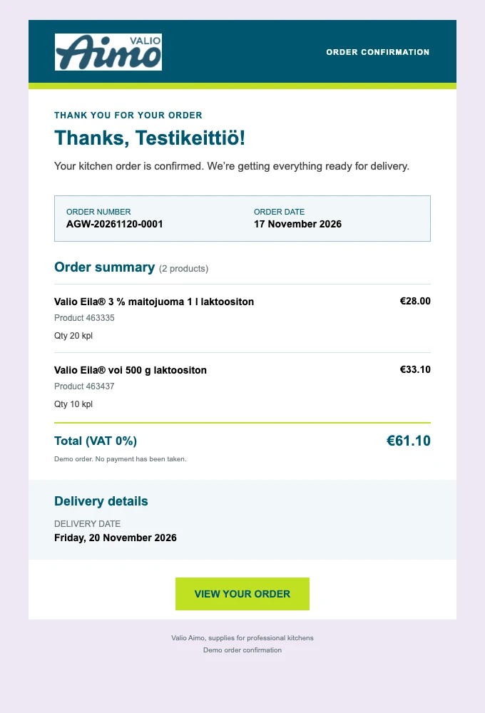
</p>

### 8. Näin agentti kokosi tilauksen

Samalla henkilökohtaisella linkillä aukeaa tilauksen jälki: keskustelu vasemmalla ja agentin ajo oikealla koodina. Siitä näkee, mitä agentti ymmärsi, mitkä vaihtoehdot se näytti ja miksi, tarjouspyynnöt portille ja portin päätösketjun. Puhelinnumerot, nimet ja linkit eivät lähde jäljen mukana.

<p align="center">
  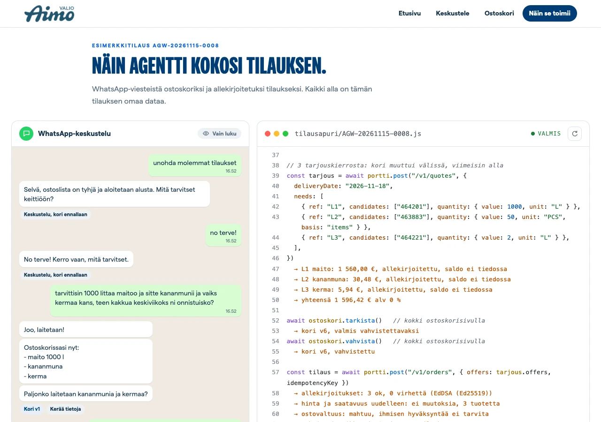
  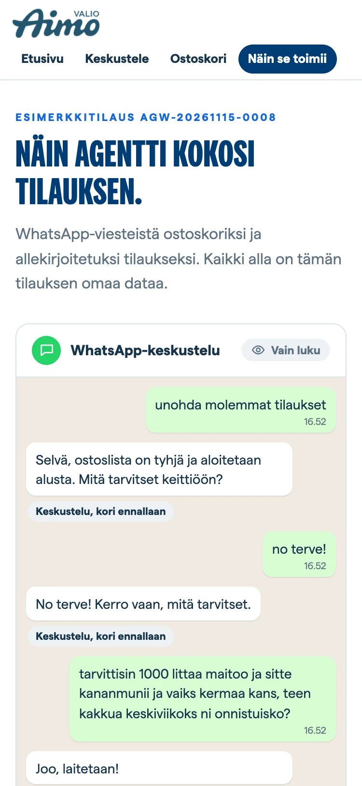
</p>

<details>
<summary>Etusivu</summary>
<p align="center">
  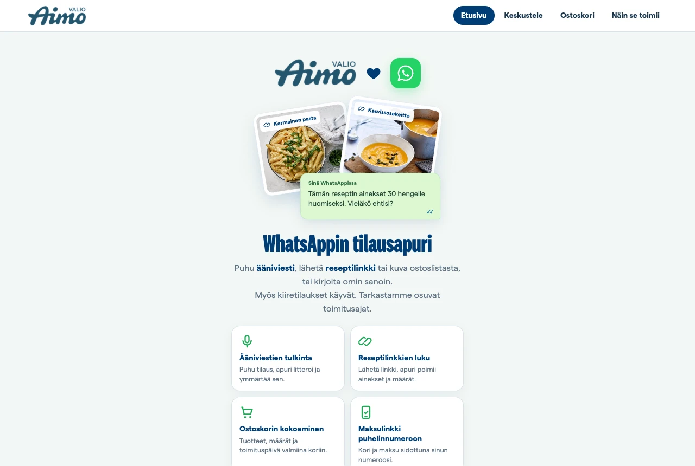
  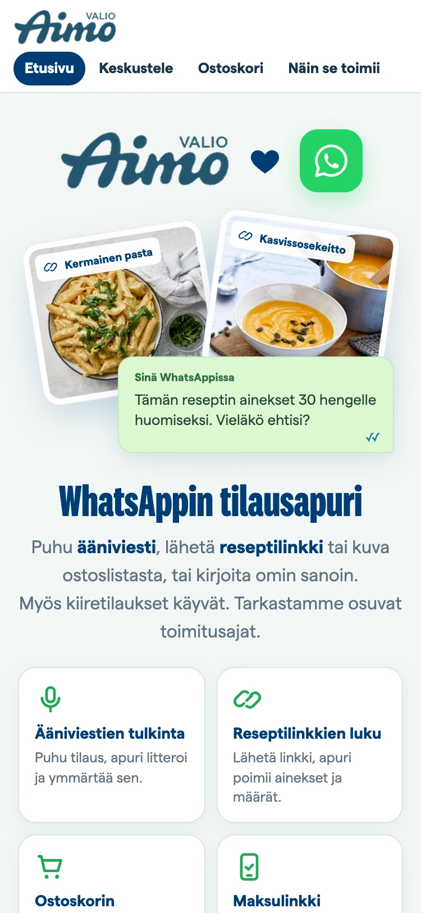
</p>
</details>

## Arkkitehtuuri

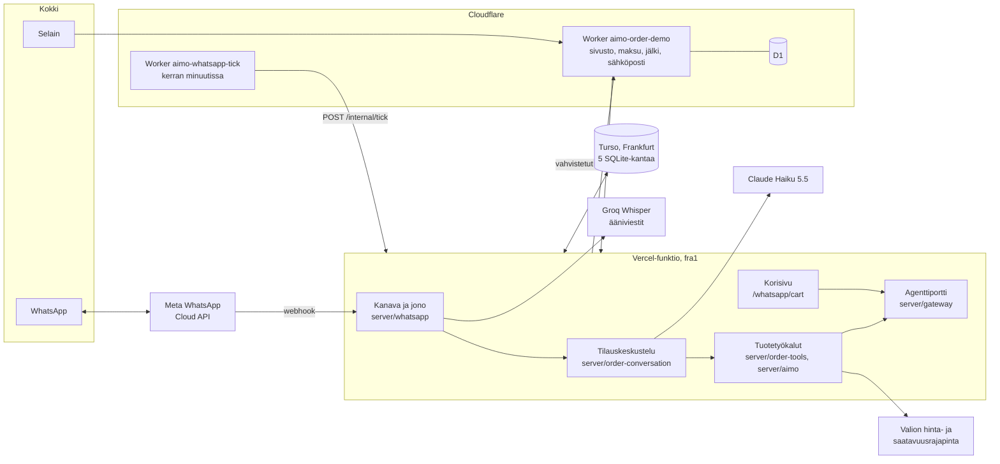

| Osa | Missä | Tehtävä |
|---|---|---|
| WhatsApp-palvelin | Vercel Hobby, `api/index.mjs` → `server/cloud.mjs` | Webhook kuitataan heti, ja jono käsitellään samassa kutsussa. Sama koodi toimii paikallisesti (`npm run whatsapp`). |
| Kannat | Turso Free, Frankfurt | Viisi SQLite-kantaa: viestijono ja jäsenet, luonnokset, tarjoukset, gatewayn tilaukset ja loki sekä hinta- ja saatavuusvälimuisti. `server/sqlite.mjs` avaa `libsql://`-osoitteen samalla rajapinnalla kuin paikallisen tiedoston. |
| Kielimalli | Claude Haiku 5.5 (`DEEP_MODEL`, `FAST_MODEL`) | Viestin tulkinta rakenteiseksi, dialogi, kuvien luku ja reseptilinkkien täsmäys. Ilman avainta viestit tulkitaan säännöillä. |
| Ääniviestit | Groq, `whisper-large-v3-turbo` | Litterointi, kun `WHATSAPP_TRANSCRIBE=groq`. |
| Agenttiportti | `server/gateway/` | Ed25519-allekirjoitetut tarjoukset (JWS), tuore hinta- ja saatavuustarkistus, ostajan mandaatti, ihmisen hyväksyntä, idempotenssi ja hash-ketjutettu päätösloki. Tarjoaa myös REST-, MCP- ja OpenAPI-rajapinnat muille ostoagenteille. |
| Mandaatti | `server/gateway/mandate.mjs` | Ostajan valtuus datana: hyväksyntätaso (aina, poikkeuksissa tai itsenäisesti), tilaus- ja päiväkatto, vaaditut merkinnät, kielletyt allergeenit ja korvaussäännöt. Malli voi ehdottaa, koodi päättää. |
| Sivusto | Cloudflare Worker `aimo-order-demo` ja D1 (`deploy/cloudflare/`) | Etusivu, selainkeskustelu, ostoskorin välitys, Näin se toimii, demomaksu, agentin jälki ja vahvistussähköposti. |
| Ajastin | Cloudflare Worker `aimo-whatsapp-tick` (`deploy/vercel/tick/`) | Kerran minuutissa: keskeytyneet käsittelyt takaisin jonoon, lähetysten uusinta, tilausten ja jälkien välitys Workeriin sekä siivous. |

Selainkeskustelu ja WhatsApp käyttävät samaa bottia ja samoja kantoja. Worker välittää selaimen viestit botille jaetulla salaisuudella (`WEBCHAT_SECRET`), ja jokainen selain saa oman keksityn testiasiakkaan. Puhelimella sivusto ohjaa keskustelemaan WhatsAppissa.

## Kansiot

| Kansio | Sisältö |
|---|---|
| `server/whatsapp/` | Meta-kanava, jono, numeroliitos, dialogi, korilinkki ja korisivu, kuvat (`media.mjs`), ääniviestit (`transcribe.mjs`), reseptilinkit (`link-*.mjs`) ja selainkeskustelu (`web-chat.mjs`) |
| `server/order-conversation/` | Tilausluonnos, tarkennukset, toimituspäivä, tulkinta ja vastausten sanamuoto |
| `server/order-tools/` | Tuotevaihtoehdot ja niiden syyt, tarjoukset ja vahvistus |
| `server/aimo/`, `server/storefront.mjs`, `server/valioApi.mjs`, `server/allergens.mjs` | Tuotehaku puhekielestä, pakkausmäärät, allergeenit, hinta ja saatavuus |
| `server/gateway/` | Agenttiportti: tarjoukset, tilaukset, mandaatit, allekirjoitukset ja päätösloki |
| `server/cloud.mjs`, `server/sqlite.mjs`, `api/` | Pilviajo Vercelissä ja Turso-kannat |
| `public/` | Korisivu, hyväksyntänäkymä, paikallinen selainkokeilu ja niiden tyylit |
| `deploy/cloudflare/` | Demosivusto Workerina: sivut, D1-skeemat, tilausten julkaisija ja Workerin testit |
| `deploy/vercel/` | Kantojen siirto Tursoon, asetusten vienti ja minuuttiajastin |
| `deploy/whatsapp/` | Kontti omalle palvelimelle |
| `test/`, `eval/`, `scripts/` | Testit, keskusteluarvioinnit ja ylläpitotyökalut |
| `docs/` | Ohjeet, `docs/kuvat/` README:n kuville ja `docs/parallel/` sessioiden raporteille |

## Ajo paikallisesti

Node.js 22.13 tai uudempi.

```bash
npm ci
cp .env.example .env
npm run fetch-data
npm run catalog
npm run whatsapp
```

`fetch-data` ja `catalog` tarvitsevat haasteen lähdeaineiston, jonka käyttö on rajattu haasteeseen. Aineistoa, katalogia ja avaimia ei tallenneta GitHubiin. Täytä Meta-asetukset ja tietokantapolut [WhatsApp-ohjeen](docs/whatsapp.md) mukaan.

| Asetus | Vaikutus |
|---|---|
| `WHATSAPP_ORDERING_ENABLED=true` | Tilauspolku käyttöön (muuten vain lukeva apuri) |
| `ANTHROPIC_API_KEY` | Kielimalli käyttöön; ilman sitä viestit tulkitaan säännöillä |
| `VALIO_API_KEY` | Haasteen hinta- ja saatavuusrajapinta; ilman sitä hinnat ja saatavuus simuloidaan |
| `VALIO_FALLBACK=last-known` | Rajapinnan katkoksessa käytetään viimeisimpiä oikeita hintoja, ja kori kertoo, ettei hinta ole ajantasainen |
| `WHATSAPP_TRANSCRIBE=groq`, `GROQ_API_KEY` | Ääniviestit käyttöön |
| `DEMO_NOW`, `DEMO_NOW_LOOP_MINUTES` | Demokello. Haasteen testirajapinta on jäädytetty (toimitus ma 16.11.2026, tilausaika päättyy su 15.11. klo 17.00), joten esimerkiksi `DEMO_NOW=2026-11-15T09:00:00+02:00` ja `DEMO_NOW_LOOP_MINUTES=420` pitävät kellon tilausajan sisällä |

Paikallisen palvelimen osoitteet:

| Osoite | Käyttö |
|---|---|
| `/webhooks/whatsapp` | Metan allekirjoitettu webhook |
| `/whatsapp/cart#…` | Yksityinen korilinkki |
| `/healthz` | Terveystarkistus; tilaustilassa `ordering-demo` |
| `/demo` | Sama keskustelu selaimessa omalla testiasiakkaalla, vain palvelinkoneelta |

`npm start` käynnistää lisäksi paikallisen kaupan ja agenttiportin rajapinnat: `POST /v1/products/search`, `POST /v1/quotes`, `POST /v1/orders`, `GET /v1/orders/{id}`, `/mcp` ja `/openapi.json`. Sopimus on tiedostossa `server/gateway/contract.mjs`. Pilvessä nämä reitit eivät näy ulos.

Korisivu ja sivusto käyttävät Valio Aimon Matter- ja National 2 -fontteja kansioista `public/storefront-assets/` ja `deploy/cloudflare/public/fonts/`. Siistissä kopiossa niitä ei jaeta; ilman niitä sivut käyttävät järjestelmän fonttia.

## Testit

```bash
npm test
npm --prefix deploy/cloudflare test
npm run aimo:eval
npm run aimo:eval:spoken
```

Testit käyttävät omia tilapäisiä kantoja ja simuloituja ulkoisia palveluita, eivätkä ne kutsu Metaa, Valiota tai kielimallia. Katalogia tarvitsevat testit ohitetaan, jos `data/catalog.json` puuttuu, joten GitHub Actions ajaa kaiken muun jokaisesta pushista. `npm run eval` käyttää haasteen oikeaa mock-rajapintaa ja kuluttaa sen kiintiötä. Keskusteluarvioinnit (`scripts/whatsapp-*`) käyttävät oikeaa kielimallia ja ajetaan käsin.

## Rajat

- **Metan testinumero:** WhatsAppissa apurille voi viestiä vain numero, jonka ylläpitäjä on lisännyt Metan testivastaanottajaksi ja yhdistänyt testiasiakkaaksi kutsukoodilla. Kaikille avoin käyttö vaatii oman yritysnumeron. Selainkeskustelu toimii kaikille.
- **Demotilaukset:** tilaukset, maksut ja sähköpostit ovat demoja. Oikeaa Valio-tilausta, maksua tai toimitusta ei tehdä. Sähköposti lähtee vain demon testiosoitteeseen ja vain, kun lähettäjä (Cloudflare Email tai Resend) on asetettu.
- **Valion oikeat rajapinnat puuttuvat:** hinnat ja saatavuus tulevat haasteen jäädytetystä testirajapinnasta ja sen katkoksessa viimeisimmistä tunnetuista arvoista. Tuotannossa asiakastunnistus, asiakaskohtaiset hinnat, tilausrajapinta ja ostovaltuudet tulevat Valion järjestelmistä; tässä ne korvataan testiasiakkailla ja demomandaateilla.
- **Kielimalli voi erehtyä:** siksi tilauksen sisällön, hinnat ja hyväksynnän ratkaisee koodi, ja kokki tarkistaa korin aina itse ennen tilausta.

## Ohjeet

- [WhatsAppin asetukset](docs/whatsapp.md)
- [Pilvijulkaisu: Vercel ja Turso](docs/vercel.md)
- [Selainkeskustelu](docs/web-chat.md)
- [Agentin jälki](docs/agent-trace.md)
- [WhatsApp-palvelin omalle koneelle](docs/whatsapp-deploy.md)
- [Tilauspolun kokeilu](docs/ordering-demo.md)
- [Cloudflare-osuus](docs/cloudflare.md)
- [Tilaustapahtumat ja sähköposti](docs/order-events.md)
- [Hakukerros ja kielimalli](docs/aimo-malli.md)

## Kuvista

Kuvat on otettu 17.11.2026 julkiselta demosivustolta 1280 ja 375 pikselin leveydellä. Keskustelu ja kori ovat selainkeskustelun keksityltä testiasiakkaalta (Testikeittiö), eikä niistä tehty tilausta. Maksusivu ja sähköposti on kuvattu samasta koodista paikallisesti keksityllä demotilauksella, koska maksulinkki on aina henkilökohtainen. Agentin jälki on demon julkinen esimerkkitilaus.

## Kehitys

Projektia kehitetään rinnakkain usealla Claude Code- ja Codex-sessiolla. Yhteiset työohjeet ovat tiedostossa [AGENTS.md](AGENTS.md), ja jokainen valmis työvaihe kirjataan tiedostoon [TYOLOKI.md](TYOLOKI.md) samaan committiin. Sessioiden tarkemmat raportit ovat kansiossa `docs/parallel/`. Muutokset tuodaan siistiin kopioon synkkausskriptillä, eikä samaa muutosta tehdä käsin molempiin repoihin.

## Tekijät

Junction 2026 -tiimi: [eeputti](https://github.com/eeputti), [DanielTurkkinen](https://github.com/DanielTurkkinen), [KarvaMaki-create](https://github.com/KarvaMaki-create) ja [Wonderlust-gi](https://github.com/Wonderlust-gi). MIT-lisenssi.
